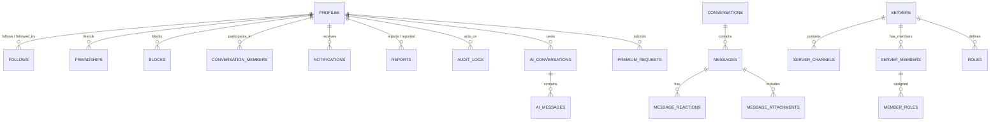

# DevSphere Database Schema Specification

---

## 1. Relational Entity Overview

DevSphere is backed by a normalized PostgreSQL schema designed for high-concurrency real-time messaging, social graphs, granular access control, audit logging, and AI token tracking.

---

## 2. Table Definitions & Primary Columns

### 2.1 Profiles & Identity
- **`profiles`**:
  - `id` (UUID, PK)
  - `email` (TEXT, UNIQUE, NOT NULL)
  - `password_hash` (TEXT, NOT NULL)
  - `username` (VARCHAR(30), UNIQUE, NOT NULL)
  - `display_name` (VARCHAR(50), NOT NULL)
  - `avatar_url` (TEXT)
  - `banner_url` (TEXT)
  - `bio` (VARCHAR(300))
  - `links` (JSONB default '[]')
  - `custom_status` (VARCHAR(100))
  - `platform_role` (VARCHAR(30) default 'USER') -- SUPREME_OWNER, PLATFORM_ADMIN, PLATFORM_MODERATOR, SUPPORT, PREMIUM_USER, USER
  - `account_state` (VARCHAR(20) default 'active') -- active, restricted, suspended, banned, deleted
  - `is_verified` (BOOLEAN default false)
  - `is_private` (BOOLEAN default false)
  - `created_at` (TIMESTAMPTZ default NOW())
  - `updated_at` (TIMESTAMPTZ default NOW())
- **`user_settings`**:
  - `user_id` (UUID, PK, FK -> profiles.id)
  - `theme` (VARCHAR(20) default 'dark') -- dark, light, system, cyber, emerald, obsidian
  - `chat_density` (VARCHAR(20) default 'cozy') -- compact, cozy
  - `direct_message_privacy` (VARCHAR(20) default 'everyone') -- everyone, friends, verified
  - `friend_request_privacy` (VARCHAR(20) default 'everyone') -- everyone, friends_of_friends, none
  - `sound_enabled` (BOOLEAN default true)
  - `email_notifications` (BOOLEAN default false)
- **`user_presence`**:
  - `user_id` (UUID, PK, FK -> profiles.id)
  - `status` (VARCHAR(20) default 'offline') -- online, idle, dnd, offline
  - `last_seen_at` (TIMESTAMPTZ default NOW())

### 2.2 Social Graph
- **`follows`**: `follower_id` (UUID), `following_id` (UUID), `created_at` (PK: (follower_id, following_id))
- **`follow_requests`**: `id` (UUID), `requester_id` (UUID), `target_id` (UUID), `status` ('pending', 'accepted', 'rejected'), `created_at`
- **`friendships`**: `user_a_id` (UUID), `user_b_id` (UUID), `created_at` (PK: (user_a_id, user_b_id), check user_a_id < user_b_id)
- **`friend_requests`**: `id` (UUID), `sender_id` (UUID), `receiver_id` (UUID), `status` ('pending', 'accepted', 'rejected', 'cancelled'), `created_at`
- **`blocks`**: `blocker_id` (UUID), `blocked_id` (UUID), `created_at`
- **`mutes`**: `user_id` (UUID), `muted_user_id` (UUID), `created_at`

### 2.3 Direct Messaging & Group Chats
- **`conversations`**:
  - `id` (UUID, PK)
  - `type` (VARCHAR(10)) -- 'direct' or 'group'
  - `name` (VARCHAR(100), nullable for DMs)
  - `icon_url` (TEXT)
  - `description` (TEXT)
  - `created_by` (UUID, FK -> profiles.id)
  - `created_at`, `updated_at`
- **`conversation_members`**:
  - `conversation_id` (UUID, FK)
  - `user_id` (UUID, FK)
  - `group_role` (VARCHAR(20) default 'MEMBER') -- GROUP_OWNER, GROUP_ADMIN, GROUP_MODERATOR, MEMBER
  - `joined_at`, `last_read_message_id` (UUID)
- **`messages`**:
  - `id` (UUID, PK)
  - `conversation_id` (UUID, nullable, FK)
  - `channel_id` (UUID, nullable, FK -> server_channels.id)
  - `sender_id` (UUID, FK -> profiles.id)
  - `content` (TEXT NOT NULL)
  - `reply_to_id` (UUID, nullable, FK -> messages.id)
  - `is_pinned` (BOOLEAN default false)
  - `is_edited` (BOOLEAN default false)
  - `is_deleted` (BOOLEAN default false)
  - `created_at`, `updated_at`
- **`message_reactions`**: `message_id`, `user_id`, `emoji`, `created_at` (PK: (message_id, user_id, emoji))
- **`message_attachments`**: `id`, `message_id`, `file_name`, `file_size`, `mime_type`, `file_url`, `created_at`

### 2.4 Community Servers
- **`servers`**:
  - `id` (UUID, PK)
  - `name` (VARCHAR(100) NOT NULL)
  - `description` (TEXT)
  - `icon_url` (TEXT)
  - `banner_url` (TEXT)
  - `owner_id` (UUID, FK -> profiles.id)
  - `is_public` (BOOLEAN default true)
  - `verification_level` (VARCHAR(20) default 'none')
  - `created_at`, `updated_at`
- **`server_members`**:
  - `server_id` (UUID, FK)
  - `user_id` (UUID, FK)
  - `nickname` (VARCHAR(50))
  - `server_role` (VARCHAR(30) default 'MEMBER') -- SERVER_OWNER, SERVER_ADMIN, SERVER_MODERATOR, MEMBER
  - `joined_at` (TIMESTAMPTZ default NOW())
- **`server_categories`**: `id`, `server_id`, `name`, `position`, `created_at`
- **`server_channels`**: `id`, `server_id`, `category_id`, `name`, `type` ('text', 'announcement', 'ai-help', 'project'), `topic`, `position`, `is_private`, `slow_mode_seconds`
- **`roles`**: `id`, `server_id`, `name`, `color`, `position`, `permissions` (BIGINT or JSONB)
- **`member_roles`**: `server_id`, `user_id`, `role_id`
- **`invites`**: `id`, `code` (VARCHAR(20) UNIQUE), `server_id`, `created_by`, `max_uses`, `uses`, `expires_at`, `created_at`

### 2.5 Premium Subscriptions & Contact-to-Purchase
- **`premium_tiers`**: `id`, `name` ('Pro', 'Supreme Dev'), `price_monthly`, `benefits` (JSONB)
- **`premium_subscriptions`**: `user_id` (UUID, PK), `tier_id` (VARCHAR), `status` ('active', 'expired', 'revoked'), `granted_by` (UUID), `expires_at`, `source`, `reference_note`
- **`premium_requests`**:
  - `id` (UUID, PK)
  - `user_id` (UUID, FK -> profiles.id)
  - `tier_id` (VARCHAR)
  - `status` (VARCHAR(30) default 'pending') -- pending, contacted, awaiting_verification, approved, rejected, cancelled
  - `contact_message` (TEXT)
  - `payment_reference` (VARCHAR(100))
  - `reviewed_by` (UUID, FK -> profiles.id, nullable)
  - `internal_note` (TEXT)
  - `created_at`, `updated_at`
- **`premium_history`**: `id`, `user_id`, `action`, `actor_id`, `tier_id`, `note`, `timestamp`

### 2.6 AI Assistant & Quotas
- **`ai_conversations`**: `id` (UUID, PK), `user_id` (UUID, FK), `title` (VARCHAR(100)), `model` (VARCHAR(50)), `created_at`, `updated_at`
- **`ai_messages`**: `id` (UUID, PK), `conversation_id` (UUID, FK), `role` ('user', 'assistant', 'system'), `content` (TEXT), `tokens_used` (INT), `created_at`
- **`ai_usage`**: `user_id` (UUID), `date` (DATE), `prompt_tokens` (INT), `completion_tokens` (INT), `requests_count` (INT)

### 2.7 Trust, Safety & Administration
- **`reports`**: `id`, `reporter_id`, `target_type` ('user', 'message', 'server', 'group'), `target_id`, `reason_category`, `explanation`, `status` ('pending', 'investigating', 'resolved', 'dismissed'), `assigned_to`, `created_at`, `updated_at`
- **`moderation_actions`**: `id`, `actor_id`, `target_id`, `action_type` ('warn', 'timeout', 'ban', 'delete_content'), `duration_seconds`, `reason`, `created_at`
- **`appeals`**: `id`, `user_id`, `moderation_action_id`, `statement`, `status` ('pending', 'approved', 'rejected'), `reviewed_by`, `created_at`
- **`audit_logs`**: `id`, `actor_id`, `action`, `target_id`, `reason`, `metadata` (JSONB), `ip_hash`, `created_at`
- **`feature_flags`**: `key` (VARCHAR, PK), `enabled` (BOOLEAN), `description` (TEXT), `updated_by` (UUID), `updated_at`
- **`announcements`**: `id`, `title`, `content`, `badge_type`, `is_active`, `created_by`, `created_at`
